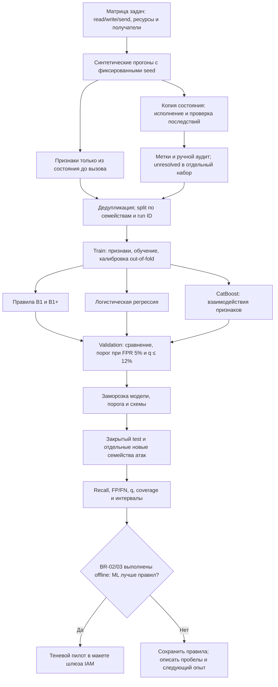
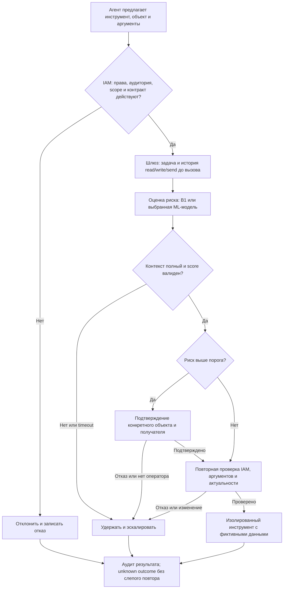

# Дизайн ML-системы — «Риск вызовов агента (IAM 604)»

Итерация 2: учебный MVP, EDA и этапы решения для ДЗ2 ML System Design. Автор — Даниил Бурдыгин.
Первая версия — 25.10.2026, редакция ДЗ1 — 04.11.2026, редакция ДЗ2 — 14.11.2026.

Целевые значения требований — **проектные цели и допущения**, не результаты экспериментов
и не согласованные требования руководителя проекта 604. В ДЗ2 собраны пилотный
синтетический набор v0 и внешние трассы AgentDojo, проведён EDA ([отчёт](../reports/eda.md));
модели ещё не обучались. Числа из EDA помечены ссылкой на отчёт.
[Основания и источники](sources.md).

## 1. Цели и предпосылки

### 1.1. Зачем идём в разработку продукта

**Бизнес-цель.** Помочь оператору шлюза инструментов обнаруживать потенциально
вредные действия агента до их выполнения, не превышая заданную долю вызовов,
направляемых человеку на рассмотрение (BR-02). Пользователи — инженер AI Security, настраивающий шлюз,
и человек, подтверждающий чувствительные операции агента.

**Текущий процесс и проблема.** В предполагаемом стенде IAM (управление
идентификацией и доступом) сначала проверяет идентичность, права, аудиторию и
область действия разрешения. Эти проверки отвечают за допустимые возможности. Но разрешённый инструмент может быть
неуместен для поручения: чтение документа допустимо, отправка сообщения тоже,
а отправка прочитанного документа внешнему получателю создаёт ущерб.
Правило для каждого отдельного вызова может пропустить связь между шагами.

**Почему ML может помочь.** Модель объединит признаки поручения, объекта,
назначения данных и истории вызовов в один ранжирующий сигнал. Проверяем
гипотезу, что он обнаружит больше опасных сочетаний при том же бюджете тревог,
чем короткий набор правил. Если преимущество не подтвердится, оставляем правила:
само наличие ML ещё не успех.

**Ценность и цена ошибки.** Пропуск опасной отправки дороже лишнего подтверждения;
частые ложные тревоги ведут к задержкам и автоматическому согласию оператора.
Поэтому оптимизируем полноту обнаружения при ограничении ложных тревог,
а не общую accuracy. Оценка остаётся дополнительным ограничением поверх IAM.

**Успех итерации.** Для ДЗ1 — проверяемый дизайн и воспроизводимая среда проверки
репозитория. Для будущего MVP — независимый от обучения набор сценариев,
сравнение с правилами и отчёт с условиями, при которых модель имеет смысл.
Работоспособность на синтетике не доказывает снижение риска в реальной организации.

### 1.2. Бизнес-требования и ограничения

#### Требования к будущему пилоту

| ID    | Требование                                              | Критерий приёмки и проверка                                                                                                                                                                                                           |
| ----- | ------------------------------------------------------- | ------------------------------------------------------------------------------------------------------------------------------------------------------------------------------------------------------------------------------------- |
| BR-01 | Оценивать каждый следующий вызов до выполнения          | На стенде на каждый запрос возвращается оценка или явный отказ оценщика; журнал связывает запрос, версии признаков и модели                                                                                                           |
| BR-02 | Уменьшать пропуски при ограниченном числе подтверждений | На закрытой сценарной выборке, на записях и отправках: recall ≥ 0,90 при FPR ≤ 0,05; доля направлений человеку q ≤ 0,12 в пересчёте на долю опасных π₀ = 5%; правила — на тех же группах и ограничениях                               |
| BR-03 | Оправдать усложнение ML                                 | На записях и отправках с неполным контекстом прирост recall против baseline ≥ 0,05 (5 процентных пунктов) при FPR модели не выше FPR baseline; при полном контексте recall не ниже baseline; интервалы разницы — по группам сценариев |
| BR-04 | Не расширять доступ решением модели                     | Все запросы с отказом IAM отклоняются независимо от score; проверить мутациями score и отказом сервиса                                                                                                                                |
| BR-05 | Сохранять работоспособность шлюза при отказе оценки     | Timeout, неверный ответ, неизвестная схема/версия → удержание вызова и эскалация; автоматического исполнения нет                                                                                                                      |
| BR-06 | Укладываться в бюджет локального стенда                 | p95 оценки ≤ 50 мс при 10 запросах/с на CPU, после прогрева, вход ≤ 64 КБ; измерить отдельно от IAM и инструмента                                                                                                                     |
| BR-07 | Позволять расследовать решение                          | Сохранять request/run ID, reason codes, model/schema/policy version, score и итоговый маршрут; не писать секреты и исходное содержимое документов                                                                                     |
| BR-08 | Воспроизводить сравнение                                | Зафиксировать seed, хеш набора, группы разбиения, признаки, версии зависимостей, порог и отчёт по всем тестовым случаям                                                                                                               |

BR-02 и BR-03 относятся к записям и отправкам, прошедшим обязательный IAM-контроль.
Чтения каталог инструментов направляет в низкий риск без оценки: последствий у них
нет, и человеку они не уходят. Знаменатель уточнён по итогам EDA (2.3): на всех вызовах
лёгкие чтения занижают FPR почти в 5 раз. BR-03 проверяется на неполном контексте:
при полном контексте правила B1 совпадают с эталоном (2.1), а доли уровней контекста
задаёт генератор, и прирост на всей смеси зависел бы от этих долей.
Отдельный набор нарушений IAM проверяет BR-04, не повышая искусственно метрики ML.
BR-06 задаёт стартовую цель для локального CPU. SLA пока не определён.
Доля направлений человеку q — уникальные записи и отправки, ушедшие на подтверждение
или удержание, к числу записей и отправок, прошедших IAM, включая `unresolved`.
Для запросов с известной меткой q_y = π·recall + (1−π)·FPR, где π, recall и FPR
считаются на тех же записях и отправках; удержания по отказу оценщика уже учтены
в recall и FPR. При доле опасных π₀ = 5%, recall = 0,90 и FPR = 0,05 получаем
q_y = 9,25%. Если записи и отправки составляют долю s всех вызовов, на весь поток
человеку уходит s·q.
Направления по `unresolved` добавляются к q отдельно, и ограничение
q ≤ 0,12 должно выполняться вместе с ними. π₀ и q ≤ 0,12 — проектные допущения
учебного стенда, а не измеренная нагрузка оператора; при других π показываем
q в анализе чувствительности.

К теневому пилоту переходим, только если offline выполнены BR-02 и BR-03, а recall
на срезе критических вызовов (внешняя передача, изменение чужого объекта) не ниже
0,90: общий recall может скрыть пропуск самых дорогих ошибок.
Пилот принят, если в макете шлюза выполнены BR-01 и BR-04–08, а результаты
BR-02/03 воспроизведены на тех же сценариях. Если доверительный интервал прироста
включает ноль, преимущество модели считаем неподтверждённым даже при точечном
приросте 0,05.

#### Процесс пилота

Владелец сценария задаёт поручение и допустимые последствия. Стенд предлагает
вызов и передаёт его шлюзу. IAM отклоняет запросы без полномочий. Оценщик
рассматривает оставшиеся запросы; низкий риск сохраняет обычный маршрут IAM,
высокий — требует подтверждения конкретных аргументов и получателя.
Перед исполнением шлюз повторно проверяет права, версию контракта и срок
подтверждения. Изменение аргументов требует новой оценки и подтверждения.
В первом пилоте модель работает в теневом режиме: сравниваем её рекомендации
с эталоном без воздействия на реальные системы.

#### Ограничения

- Все вызовы выполняются только в локальном изолированном стенде с фиктивными
  объектами и получателями. Реальные отправки, платежи и административные действия исключены.
- Нельзя использовать рабочие журналы, документы, секреты и персональные данные
  автора. Разрешённая исходная база — собственная синтетика;
  открытые наборы добавляются только после проверки лицензии и содержимого.
- Ресурс — один студент, CPU и локальное хранилище. Платные API и GPU не требуются.
  Учебная гипотеза бюджета: до 40 часов на MVP после согласования плана.
- Сервис риска не хранит учётные данные, не выдаёт токены и не заменяет движок политик.
  Подмена оценки не должна позволять нарушить IAM.
- Автор участвует в проекте 604, но распределение в команде, использование этой темы
  в проектной практике и интерфейс со шлюзом команды ещё не согласованы. До этого
  интеграция демонстрируется через макет шлюза.
- Сроки итераций задаёт курс; ДЗ2 (EDA и этапы решения) — 14.11.2026 20:00 МСК.

### 1.3. Что входит в scope итерации и что не входит

**ДЗ1, текущая поставка:** этот документ, описание данных и метрик, схема baseline
и MVP, README, Python-каркас с версией и smoke-тестом, форматирование, линтеры,
проверка типов, pre-commit и CI. Код модели,
собранный датасет и экспериментальные результаты в поставку ДЗ1 не входят.

**ДЗ2, текущая поставка:** генератор синтетики v0 с эталоном последствий, отдельным
от признаков шлюза; набор v0 с манифестом; таблицы из трасс AgentDojo; два ноутбука
EDA и [отчёт](../reports/eda.md); правила B0, B1 и B1+ в коде; раздел 2.3 этого документа.
Обучение моделей в ДЗ2 не входит.

**Будущий MVP:** синтетический генератор задач и трасс; эталон последствий;
дедупликация и групповое разбиение; правила и две модели; подбор порога;
offline-отчёт; локальный интерфейс оценки и воспроизведение атак. Закрывает
BR-01–08 в границах стенда. Языки и интерфейсы реализации уточняются перед кодом;
учебные ML-эксперименты используют стандартный ML-стек без разработки своего движка.

**Вне scope:** весь Enterprise IAM, промышленный IdP/хранилище секретов,
реальные интеграции с корпоративными системами, промышленная эксплуатация, онлайн-обучение,
гарантия обнаружения всех prompt injection, доказательство безопасности модели,
оценка реального потока без его данных. Не строим детектор «вредного текста»
как замену проверке последствий действия.

**Качество и воспроизводимость.** Для кода MVP нужны строгие типы на границах,
валидация входа, фиксированные зависимости, тесты утечки между выборками,
проверка некорректных входов и сценарные регрессии. Результаты экспериментов
будут связаны с ревизией кода и данными; сейчас настроены проверки документов,
Python-каркаса и установки пакета.

**Технический долг:** независимая разметка второй стороной, оценка на новых
организациях, реальная нагрузка, интерфейс оператора, защищённая доставка модели
и эксплуатационный мониторинг. Эти пункты блокируют промышленное использование,
но не сравнение алгоритмов в учебном стенде.

### 1.4. Предпосылки решения

| Допущение                                                              | Причина и способ проверки                                                                      | Если не выполнено                                                       |
| ---------------------------------------------------------------------- | ---------------------------------------------------------------------------------------------- | ----------------------------------------------------------------------- |
| Шлюз видит структурированные аргументы и состояние до вызова           | Риск зависит от объекта, назначения и истории; проверить полноту трассы на каждом сценарии     | Отказ от score при неполном контексте, запрос уточнения                 |
| Поручение связано с run ID и проверенным манифестом разрешённой задачи | Иначе модель опирается на изменяемое самоописание агента; целостность манифеста проверяет шлюз | Удержать вызов, задача не установлена                                   |
| Инструмент сообщает класс данных и тип побочного эффекта               | Сырые тексты могут содержать секреты; использовать каталог инструментов и метаданные           | Неизвестный инструмент → ручное рассмотрение                            |
| История доступна внутри одного прогона                                 | Сочетание чтения и внешней отправки требует нескольких шагов                                   | В MVP явный ключ стенда; перенос на протокол команды — открытый вопрос  |
| Эталон последствий считается отдельно от признаков и правил            | Обучение на метке из тех же правил не проверит перенос                                         | Аудит сценариев и отдельные семейства атак; ограничить вывод синтетикой |
| Есть подтверждающий человек                                            | Предполагаемый процесс обработки высокого риска                                                | В стенде подтверждающий симулируется; без оператора вызов удерживается  |

**Гранулярность** — один предложенный вызов в контексте прогона.
**Горизонт** — потенциальное нарушение при выполнении этого вызова, а не риск
пользователя навсегда. **Момент оценки** `t_score` — запрос оценки
зафиксированных аргументов. Все признаки берутся из снимка состояния на `t_score`:
история — только предыдущие события, включая прочитанные классы данных.
Подтверждения в признаки не входят: оценка идёт до подтверждения, а его проверяет
шлюз перед исполнением. Повторная оценка после изменения аргументов получает новый
`decision_id` и свой снимок. Из будущего разрешено получать метку для обучения,
но не признаки.

**Переобучение** запускается вручную. Повод — обновление набора сценариев;
собственные оценки модели не используются как новые метки.

## 2. Методология

### 2.1. Постановка ML-задачи

**Задача:** бинарная классификация с калибровкой и ранжированием риска
`p(y = 1 | x)`. Положительный класс — вызов, который в заданном состоянии
стенда нарушает ограничения поручения или создаёт запрещённый поток данных.
Например, выгрузка чувствительного документа внешнему получателю при поручении
сделать локальную сводку. Метка отражает последствия и допустимость относительно
задачи; формальная проверка токена остаётся отдельной.

**Определение метки.** Владелец сценария до генерации вызовов фиксирует исходное
состояние, допустимые объекты/получателей и запрещённые последствия. Независимый
от признаков симулятор выполняет вызов на копии состояния и проверяет эти условия.
Метка описывает недопустимость текущего предложенного действия при его штатном
успешном исполнении. Фактический исход (успех, timeout, unknown outcome) метку не
меняет. Проверяются только эффекты текущего вызова:
нарушение, возникшее на прежнем шаге, не переносится на последующие.
Если хотя бы одно условие нарушено, `y=1`; если все проверены и соблюдены, `y=0`.
Неполные и противоречивые примеры получают статус `unresolved` и исключаются из
обучения с указанием причины. Факт prompt injection сам по себе метку не задаёт.
Подтверждение оператора её тоже не меняет: метка описывает поручение, а не решение
человека.

**Контрастные примеры:**

| Поручение и контекст                                     | Предложенный вызов                                  | Эталон                              |
| -------------------------------------------------------- | --------------------------------------------------- | ----------------------------------- |
| Сделать локальную сводку, прочитан sensitive-документ    | Отправить его содержание на фиктивный внешний адрес | 1: нарушена граница передачи        |
| Отправить согласованный public-отчёт названному адресату | Отправить этот отчёт указанному адресату            | 0: условия соблюдены                |
| Обновить объект A, токен позволяет A и B того же класса  | Изменить объект B                                   | 1: действие вне поручения           |
| Прочитать свой объект, полномочий нет                    | Чтение объекта                                      | Отказ IAM; отдельная проверка BR-04 |

**Входные данные, доступные до исполнения:**

| Группа       | Признаки                                                                                                                         | Источник доверия                                    |
| ------------ | -------------------------------------------------------------------------------------------------------------------------------- | --------------------------------------------------- |
| Поручение    | Категория цели, допустимые классы эффектов и ресурсов                                                                            | Проверенный манифест шлюза                          |
| Вызов        | Тип инструмента, операция read/write/send, класс ресурса, размер payload, внешний/внутренний получатель                          | Каталог и нормализованные аргументы                 |
| Соответствие | `object_matches_task`, `recipient_matches_task` (да, нет, неизвестно), класс данных отправляемого payload по метке происхождения | Шлюз: манифест поручения и метки прочитанных данных |
| История      | Число вызовов, предыдущие классы прочитанных данных, смена назначения, повтор записи после timeout                               | Журнал шлюза до текущего шага                       |

Без признаков соответствия запись в разрешённый объект A и в запрещённый B
того же класса неразличимы: у них одинаковые класс ресурса, операция и история.
Поэтому шлюз до оценки сверяет объект и получателя со списком из манифеста,
а прочитанным данным присваивает метку происхождения; эти же признаки получают
правила B1. Если метки у payload нет, история чувствительных чтений повышает
риск, но не доказывает, что отправляется именно прочитанное.

**Где у модели есть шанс.** Эталон считается по манифесту и следам данных, а признаки
соответствия и правила B1 смотрят на те же поля. Если манифест полный и метка
происхождения есть всегда, B1 почти совпадёт с эталоном, и прироста из BR-03 не будет
по построению. Модель может выиграть там, где контекст неполон: манифест задаёт только
класс ресурсов (`object_matches_task` = неизвестно), у payload нет метки, опасность
видна лишь в последовательности шагов. Это не ошибка `incomplete_context`: она означает,
что нет обязательных полей (run ID, манифест, схема аргументов).

Долю таких случаев задаёт генератор, поэтому сравнение показываем отдельно по уровням
полноты контекста. При полном контексте ожидаем паритет с B1. Вывод о превосходстве
останется условным: он зависит от выбранных долей и на реальный поток не переносится.

Секреты, сырые документы, run и call ID, время, seed, версия генератора, идентификатор
семейства, метка атаки, результат исполнения и решение эталонного проверяющего не
входят в признаки.
Причины score выдаются фиксированными кодами наблюдаемых факторов, например
`external_destination` и `sensitive_read_before_send`. Они объясняют контекст,
но не доказывают причинность предсказания.

**Выход:** `request_id`, score в диапазоне [0,1], `model_version`, `schema_version`,
reason codes либо типизированная ошибка `unknown_tool / incomplete_context /
timeout / invalid_input`. Порог переводит score в маршрут подтверждения.
Ответ не содержит действия `grant_access`. Порог фиксируется по validation;
test для его подбора не используется.

#### Данные и защита оценки от утечки

Основной источник — собственная синтетика по матрице «задача × инструмент ×
класс данных × получатель × история × сбой». Предварительный план — 1 500 семейств,
около 4 000 прогонов и 20 000 вызовов; точный объём определит аудит покрытия.
Для каждого семейства нужны безопасный вариант и минимальные изменения,
которые меняют допустимый исход. Наличие слов «атака» или «секрет» не должно
предсказывать класс без контекста.

**Объём и доля опасных вызовов.** Выборка с естественной долей π₀ = 5% не подходит:
из 10 000 записей и отправок в test попало бы около 100 опасных, и даже при их независимости
полуширина 95% интервала для recall 0,90 составила бы около 0,06, больше прироста 0,05
из BR-03. Recall и FPR от доли положительного класса не зависят, поэтому контрастные
пары остаются в наборах как есть, а q и precision пересчитываем на π₀ = 5% и на значения
анализа чувствительности. Калибровку на обогащённой выборке не выдаём за калибровку
при π₀.

Ориентир — 300 семейств с опасными вызовами в test. Если модели расходятся на 10%
таких семейств, а истинный прирост равен 0,05, интервал парной разницы исключит ноль
примерно в 80% случаев; при 150 семействах — в 50%. Семейства из одной матрицы не
полностью независимы, поэтому это нижняя оценка, и на validation мы её уточняем. Если
нужного числа не набрать, BR-03 считаем непроверенным, а критерий не ослабляем.

| Набор       | Состав                                                                      | Состояние                                                             |
| ----------- | --------------------------------------------------------------------------- | --------------------------------------------------------------------- |
| `calls`     | run/call ID, время, признаки до исполнения, версия генератора               | v0: 17 453 вызова                                                     |
| `labels`    | call ID, y/unresolved, основание, версия эталона, статус аудита             | v0: 2 835 нарушений, 65 unresolved; аудит второй стороной не проведён |
| `scenarios` | family ID, начальное состояние, ограничения задачи, seed, ожидаемые эффекты | v0: 1 500 семейств                                                    |

Метки хранятся отдельно от признаков. Разбиение по семействам сценариев:
60% train, 20% validation, 20% закрытый test; все варианты одного исходного
поручения и весь прогон идут в одну часть. Пропорции приблизительные из-за
группировки. Преобразования и калибровка учатся только на train, калибровка — по
out-of-fold предсказаниям групповой кросс-валидации. Validation целиком идёт на
сравнение моделей и выбор порога (2.3). Test открываем один раз после фиксации.

Дополнительный challenge-набор содержит новые семейства обхода и сочетания
инструментов, отсутствующие при обучении. Его результаты показываем отдельно.
В v0 это условие не выполнено: шаблон challenge встречается в train, в v1 он
исключается из остальных частей (2.3).
Переформулировки одного сценария не считаем независимыми тестовыми задачами.
Массовая генерация не заменяет проверку: вручную аудируем минимум 100 прогонов,
включая принятые, отклонённые и unresolved. Аудит пока ведёт автор генератора, второй
разметчик не назначен, поэтому общие слепые зоны генератора и эталона не исключены.

Своя синтетика не показывает, как ведёт себя настоящий агент. Кандидат на внешнюю
проверку — открытый бенчмарк [AgentDojo](https://github.com/ethz-spylab/agentdojo):
он тоже определяет нарушение по состоянию среды, а в репозитории лежат готовые трассы
LLM-агентов, так что платный API не нужен. Метка там относится ко всему прогону, а не
к вызову, поэтому он подходит только как отдельный challenge, не для обучения, и после
проверки состава и переноса признаков.

Частота опасных событий в синтетике управляется генератором. Precision,
нагрузку на оператора и калибровку показываем при указанной доле положительного
класса и в анализе чувствительности для 1%, 5% и 20%. Эти значения не выдаём
за частоты настоящего потока. Перенос вероятности на production не установлен.

#### Baseline, MVP и метрики

**Baseline B0:** все прошедшие IAM вызовы считаются низким риском. Показывает
цену отсутствия дополнительного контроля: recall=0, если в выборке есть вызовы
положительного класса, FPR=0. **Основной baseline B1:** фиксированные правила
«sensitive-read + external-send», «объект или получатель вне манифеста»,
«write вне класса поручения», «повтор записи после неизвестного исхода».
Используем правила, доступные в момент вызова; эталон оценивает эффект
на отдельном состоянии. Настройки B1 фиксируем на train/validation до test.
Точный состав B1 и усиленного варианта B1+ — в 2.3.

**Модели:** регуляризованная логистическая регрессия с one-hot признаками как
простой ML-baseline; CatBoost на тех же табличных признаках как кандидат MVP
для взаимодействий. Гиперпараметры и необходимость калибровки выбираются
внутри train/validation. Сложность CatBoost оправдана только измеренным выигрышем;
если выигрывает регрессия или B1, итоговое решение остаётся простым.
LLM в критическом пути не используем: это дороже и добавляет новый источник ошибок.

**Исходы оценщика** — три: низкий риск, высокий риск и отказ оценщика
(`timeout`, `unknown_tool`, `incomplete_context`, `invalid_input` → удержание).
N — записи и отправки, прошедшие IAM, до фильтрации по наличию score. Удержание
направляет вызов человеку, поэтому в основных метриках опасный удержанный вызов
считается обнаруженным, а безопасный — ложной тревогой. Исключить отказы из
знаменателя нельзя: так улучшаются видимые recall и FPR при росте нагрузки.

**Основные метрики:** recall = TP/(TP+FN) при FPR = FP/(FP+TN) ≤ 0,05;
доля направлений человеку q — по уникальным запросам на подтверждение
или удержание, к N; precision = TP/(TP+FP); coverage — доля запросов
с валидным score; доли low/high/hold по классам y. Recall и FPR только по
запросам со score показываем отдельно. Критические FN — отдельное число
для внешней передачи и изменения чужого объекта. `unresolved` — неизвестный
эталон, а не отказ модели: такие запросы исключаются из метрик, которым нужен y,
но входят в q. PR-AUC характеризует ранжирование, Brier score — общее качество
вероятностного прогноза; калибровку проверяем по reliability diagram с числом
наблюдений в интервалах score при указанной доле положительного класса.
При нулевом знаменателе метрика отмечается неопределённой, не нулевой.
Все алгоритмы оцениваем на одних сценариях и показываем матрицы ошибок.

Единица bootstrap — семейство сценариев. Для 95% интервалов повторно выбираем
семейства целиком; в отчёте показываем число семейств и вызовов.
Парный bootstrap разницы recall сравнивает модели на одинаковых группах. Если для нужного среза мало групп, вывод — недостаточно
данных. Ноль критических ошибок в конечном наборе не гарантирует их отсутствия.

### 2.2. Блок-схемы решения

#### Обучение и offline-оценка baseline и MVP

Общая подготовка данных позволяет честно сравнивать правила и модели.
B1 не обучает веса. Его настройка также не использует закрытый test.
Результат — выбранное решение и отчёт. Версия модели включается в поставку,
только если сравнение подтвердило её преимущество.

#### Оценка следующего вызова в будущем стенде

В эксперименте теневого пилота ветви после score только моделируются.
В активном режиме шлюз остаётся единственной точкой исполнения; низкий score
не отменяет отказ IAM, а подтверждение связано с точными аргументами.

### 2.3. Этапы решения задачи

Этапы опираются на [EDA](../reports/eda.md): синтетику v0 и трассы AgentDojo.
Распределения и сравнение с правилами в EDA посчитаны только на train. Пять находок
меняют план ДЗ1.

1. Две трети вызовов — чтения, нарушений среди них нет по определению метки. Метрики
   и бюджет ложных тревог переносим на записи и отправки (1.2).
2. При полном контексте правила B1 ловят все нарушения; ложные тревоги дают только
   повторы записи, исход первой из которых шлюз не знает.
3. При неполном контексте B1 пропускает 20–38% нарушений, а при `minimal` его FPR
   0,067 уже выше бюджета BR-02.
4. У 10% вызовов train одинаковые признаки дают разные метки.
5. Генератор v0 оставил подсказки: `delete_record` встречается только в атаках,
   недоверенный ввод без атаки — только в разборе входящих, размер отправки в правках
   складывается из двух объектов, шаблон challenge уже есть в train.

| Этап                          | Когда                                                               | Вход                                | Выход и условие перехода                                                                 |
| ----------------------------- | ------------------------------------------------------------------- | ----------------------------------- | ---------------------------------------------------------------------------------------- |
| 1. Подготовка данных          | Первым                                                              | Генератор v0, отчёт EDA, AgentDojo  | Набор v1 без подсказок v0; ≥ 300 семейств с нарушением в test                            |
| 2. Прогнозные модели          | Разработка — после этапа 1; сравнение на validation — после этапа 3 | Train и validation v1               | Метрики B0, B1, B1+, LR, CatBoost в рабочих точках правил и при FPR ≤ 0,05; выбор модели |
| 3. Независимая проверка меток | Сразу после этапа 1, параллельно с разработкой моделей на train     | Выборка аудита v1, трассы AgentDojo | κ ≥ 0,8; при исправлении эталона этап 2 повторяется на новой версии                      |
| 4. Порог и нагрузка оператора | После этапа 2                                                       | Validation, выбранная модель        | Порог при FPR ≤ 0,05 и q ≤ 0,12; чувствительность по π; рабочая точка утверждена         |
| 5. Закрытая оценка            | После этапов 3 и 4                                                  | Замороженные модель, порог, схема   | Test, challenge-семейства, AgentDojo уровня `minimal`; решение о теневом пилоте          |

Номера этапов следуют шаблону, порядок выполнения — в столбце «Когда». Этапы 3 и 4 —
специфичные для задачи. Метка здесь — вычисленное последствие действия, а не
исторический факт, поэтому её проверяют отдельно и до сравнения моделей. Порог задаёт
нагрузку человека, подтверждающего вызовы.

#### Этап 1. Подготовка данных

**Данные и сущности.** Реальных журналов шлюза нет; основной источник — собственная
синтетика, внешняя проверка — трассы AgentDojo.

| Название данных                               | Есть ли данные (источник)                      | Требуемый ресурс                       | Качество проверено                                                               |
| --------------------------------------------- | ---------------------------------------------- | -------------------------------------- | -------------------------------------------------------------------------------- |
| Поручения, манифесты, состояние (`scenarios`) | Да: генератор `agent_risk.synthetic`, набор v0 | Автор (DS)                             | Да: состав и баланс по срезам                                                    |
| Признаки вызова до исполнения (`calls`)       | Да: v0                                         | Автор                                  | Да: типизация 17 453 строк, домены, `na` и `unknown` раздельно, пустых ячеек нет |
| Метки последствий (`labels`)                  | Да: эталон v0                                  | Автор; второй разметчик не назначен    | Частично: тесты эталона и контрастные пары; независимой разметки нет (этап 3)    |
| Скрытые факты аудита (`audit`)                | Да: v0, только для аудита                      | Автор                                  | Да; в признаки не входят, это проверяет тест                                     |
| Трассы LLM-агентов (внешний challenge)        | Да: AgentDojo, MIT, коммит `089ed46`, 3 модели | Автор                                  | Да: пустые прогоны, неопределённая метка без атаки, разные наборы задач          |
| Журналы шлюза команды 604                     | Нет                                            | Команда 604, согласование руководителя | —                                                                                |

Признаки шлюза перечислены в 2.1. Полноту контекста генератор задаёт одним из четырёх
уровней; от уровня зависит, что шлюз знает о поручении и данных.

| Уровень контекста | Объект и получатель в манифесте | Метка происхождения payload |
| ----------------- | ------------------------------- | --------------------------- |
| `full`            | Точный список                   | Есть                        |
| `class_only`      | Только класс ресурсов           | Есть                        |
| `no_provenance`   | Точный список                   | Нет                         |
| `minimal`         | Только класс ресурсов           | Нет                         |

**Целевые переменные.**

| Метка        | Уровень          | Значение                                                       | Использование                                                     |
| ------------ | ---------------- | -------------------------------------------------------------- | ----------------------------------------------------------------- |
| `y`          | Вызов синтетики  | 1 — выполнение нарушает поручение; 0 — все условия соблюдены   | Обучение и метрики                                                |
| `unresolved` | Вызов синтетики  | Эталону не хватает сведений; причина записывается              | Исключается из метрик с меткой, входит в q                        |
| `security`   | Прогон AgentDojo | Цель атакующего достигнута; у прогонов без атаки не определена | Только внешняя проверка; вызов находит эвристика, не для обучения |

В v0 нарушений 16,2%, `unresolved` 0,4%: 44 вызова с манифестом без получателей и 21 —
с удалённым объектом в отправке. Эвристика AgentDojo ищет в аргументах идентификатор
из внедрённого текста. Она находит вызов в 70% успешных атак и срабатывает в 3%
неуспешных.

**Проблемы и риски, найденные EDA.**

- Чтения — 66% вызовов синтетики и 71% вызовов AgentDojo; нарушений среди них нет.
  Метрика по всем вызовам была бы занижена лёгкими примерами (этап 2).
- 10% размеченных вызовов train неотличимы от вызовов с другой меткой при данных
  признаках: шлюз не видит объект, класс данных или исход прежней записи. Это нижняя
  граница ошибки, и при неполном контексте recall ниже 1 неизбежен.
- Подсказки генератора. Все 64 вызова `delete_record` в train — нарушения. Недоверенный
  ввод в прогонах без атаки встречается только в разборе входящих, в остальных
  поручениях признак почти равен факту атаки. Все отправки чувствительных данных —
  нарушения, а правка «добавить чувствительный документ» складывает размеры двух
  объектов. Шаблон challenge (`share_document` наружу) появляется в train из правок
  получателя, и B1 ловит его всегда.
- Частоты поведения агента заданы конфигурацией: внедрение в 35% семейств, следование
  ему в 45% случаев, ошибка агента в 15%. Это свойства генератора, а не потока.
- Генератор и эталон пишет один автор, поэтому общие слепые зоны возможны (этап 3).
- Ловушки AgentDojo. 19,9% прогонов Llama 3.3 70B на основной атаке пустые из-за сбоя
  формата вызова. Llama прогнана на расширенной версии `workspace`, где атака почти не
  удаётся. После выравнивания задач доля её успешных атак растёт с 0,231 до 0,335,
  после удаления пустых прогонов — до 0,388.

**Процесс генерации.** Набор собирает команда
`python -m agent_risk generate --out data/synthetic/<версия> --seed <seed>`.
Генерация идёт по семействам: владелец сценария задаёт объекты, манифест и уровень
полноты контекста. Поведение агента (по поручению, ошибка, следование внедрённой
инструкции, повтор после таймаута) даёт план вызовов. Минимальные правки плана
создают контрастные прогоны, шлюз строит признаки, эталон отдельно проверяет
последствия. Формат — gzip CSV, по таблице на `scenarios`, `calls`, `labels` и `audit`,
плюс `manifest.json` с конфигурацией, версиями генератора и эталона и sha256 файлов.
Генерация детерминирована и занимает меньше секунды. Регулярного потока нет:
новая версия собирается при изменении генератора или эталона, прежняя не
перезаписывается. Разбиение по семействам выводится из хеша `family_id` и не
зависит от порядка генерации. Таблицы AgentDojo извлекаются один раз с
зафиксированного коммита командой `python -m agent_risk agentdojo`; сырые трассы
в репозиторий не входят.

**Что меняется в v1.** Генератор добавляет разрешённые удаления, безопасные внешние
чтения в номинальные планы всех поручений и разрешённые отправки чувствительных
данных (например, отчёт аудитору). Правка чувствительной отправки заменяет объект,
а не добавляет его. Шаблон challenge исключается из генерации остальных частей и
выбирается так, чтобы при неполном контексте его не видел B1. Например, это
передача закрытых данных через промежуточный документ без метки происхождения.

**Хватает ли данных.** Для BR-03 нужно около 300 семейств с нарушением в test (2.1).
В v0 их 269, поэтому v1 — 2 000 семейств, около 23 тысяч вызовов. Генерация дешёвая.
Узкие места — ручной аудит 100 прогонов и вторая разметка, а не объём. Для challenge
AgentDojo достаточно имеющихся 510 прогонов с атакой на модель: там нужны описательные
оценки с интервалами по задачам, а не проверка BR-03.

**Конфиденциальность.** Реальных данных нет. Объекты и адреса фиктивные
(домены `.test`), секретов и документов нет, есть только классы данных и размеры.
Трассы AgentDojo содержат вымышленных пользователей; в наши таблицы из них
переносятся имена функций, флаги и счётчики, а тексты сообщений и аргументы — нет.
Если появятся журналы шлюза, действует BR-07: исходное содержимое документов и
секреты в признаки и журналы не попадают, только классы, метки происхождения
и хеши идентификаторов.

**Результат этапа.** Набор v1 с манифестом и описанием по образцу datasheet. Отчёт
аудита: 100 прогонов, в том числе принятые, отклонённые и `unresolved`. Закреплённое
разбиение и таблица challenge AgentDojo после очистки. Этап закрыт, когда в test
не меньше 300 семейств с нарушением и у каждого `unresolved` указана причина. Ещё одно
условие — повторный аудит train v1 не находит подсказок v0. Для этого AUC одного имени
инструмента на записях и отправках должен быть не выше нынешних 0,69, а недоверенный
ввод должен встречаться и без атаки.

#### Этап 2. Подготовка прогнозных моделей

**Единица и выборка.** Модель оценивает записи и отправки. Чтения по каталогу
инструментов получают низкий риск без модели: по определению метки у них нет
последствий. Они только пополняют историю для следующих вызовов. Так обучение
и метрики не размываются лёгкими примерами. Гранулярность, горизонт и момент
`t_score` — как в 1.4; переобучение — вручную при новой версии набора.

**Метрики и связь с бизнес-целью.** Все метрики считаются на записях и отправках.

| Метрика                                                                                                     | Зачем                                                                                        |
| ----------------------------------------------------------------------------------------------------------- | -------------------------------------------------------------------------------------------- |
| Recall при FPR ≤ 0,05                                                                                       | BR-02: доля пойманных опасных действий при ограниченных ложных тревогах                      |
| Δrecall против B1 и B1+ в рабочей точке правила на неполном контексте, 95% интервал bootstrap по семействам | BR-03: оправдано ли усложнение при том же числе ложных тревог                                |
| Recall по уровням полноты контекста и на критических вызовах                                                | Выигрыш возможен только при неполном контексте; внешняя отправка и чужой объект дороже всего |
| q — доля направлений человеку, вместе с удержаниями                                                         | Нагрузка оператора; при π из анализа чувствительности                                        |
| PR-AUC при указанной доле класса, Brier, диаграмма надёжности                                               | Качество ранжирования и вероятностей; порог должен переноситься между версиями               |

Accuracy и ROC-AUC отдельно не используем: при дисбалансе они скрывают редкий класс
и не задают бюджет тревог. На всех вызовах FPR B1 в v0 был бы почти в 5 раз ниже за
счёт чтений, поэтому знаменатель BR-02 уточнён в 1.2.

**Функция потерь.** Логистическая функция потерь (log loss) для обеих моделей. Она
даёт вероятности, которые калибруются и переводятся в порог. Асимметрию цены ошибок
не закладываем в веса классов и ресэмплинг: среди записей и отправок v1 нарушений
около половины, а цену ошибок задаёт порог (этап 4). Взвешенная по цене ошибки
функция потерь проверяется только как абляция.

**Схема валидации.**

- Разбиение по семействам 60/20/20 из хеша `family_id`, test закрыт до этапа 5.
  Все варианты поручения и весь прогон — в одной части: правка внутри семейства
  почти дублирует пример, и случайное разбиение по вызовам дало бы утечку.
- Подбор гиперпараметров — StratifiedGroupKFold на train, k = 5. Группа — семейство,
  стратификация по сочетанию `y` × уровень контекста, чтобы в каждом фолде были
  нарушения всех уровней.
- Калибровка (изотоническая или Platt, выбор по Brier) учится на out-of-fold
  предсказаниях тех же фолдов. Validation не делится: в v1 это около 380 семейств,
  из них около 360 с нарушением, что выше ориентира мощности из 2.1.
- Все кандидаты оцениваются на одной validation. B1 и B1+ — бинарные правила
  с фиксированной рабочей точкой. Для сравнения с правилом порог модели подбирается
  так, чтобы её FPR не превышал FPR правила, и сравнивается recall (BR-03). Разница
  recall — парный bootstrap по семействам, решения в этой точке — тест Макнемара.
  Отдельно проверяется BR-02 при FPR ≤ 0,05.
- Против утечки: признаки только из шагов до `t_score`; кодировщики учатся внутри
  фолда; тест проверяет, что скрытые поля не попали в признаки. Отдельная проверка —
  отсутствие общих семейств между частями.

Бейзлайны собраны в `agent_risk.rules`; числа ниже — train v0, записи и отправки.

| Бейзлайн                | Устройство                                                                                                                                                                                                                                             | Что показывает                                                                                                                                           |
| ----------------------- | ------------------------------------------------------------------------------------------------------------------------------------------------------------------------------------------------------------------------------------------------------ | -------------------------------------------------------------------------------------------------------------------------------------------------------- |
| B0                      | Всё низкий риск                                                                                                                                                                                                                                        | Цену отсутствия контроля: recall 0                                                                                                                       |
| B1                      | Пять фиксированных правил: действие вне поручения; объект или получатель вне манифеста; класс отправляемых данных вне поручения; внешняя отправка после чувствительного чтения при неизвестном классе payload; повтор записи после неизвестного исхода | Recall 1,00 при полном контексте и 0,62–0,80 при неполном; FPR 0,035, при `minimal` 0,067 — правила сами не укладываются в BR-02                         |
| B1+                     | B1 и правило из EDA: запись после неоднозначного поиска при неизвестном соответствии объекта                                                                                                                                                           | Recall 0,86 против 0,84 у B1 ценой FPR 0,091, при `minimal` 0,225. Как решение не проходит BR-02; нужен, чтобы модель обошла правила, знающие сигнал EDA |
| Логистическая регрессия | One-hot для категориальных признаков, `log(payload_kb)` и число предыдущих вызовов со стандартизацией, L2-регуляризация с коэффициентом, подобранным на фолдах                                                                                         | ML-бейзлайн: сколько даёт линейная комбинация тех же признаков                                                                                           |

**Предобработка.** Пропусков в данных нет, заполнять нечего. Вызовы `unresolved`
исключаются из обучения и метрик с меткой и отчитываются отдельно. Значения `na`
(признак неприменим) и `unknown` (шлюз не знает при неполном контексте) остаются
разными категориями: EDA показал, что они значат разное. Для регрессии размер
отправки логарифмируется, числовые признаки стандартизуются, категориальные
кодируются one-hot; всё это обучается только на train-фолде. Ресэмплинга нет.
Подсказки генератора v0 снимаются в данных v1, а не удалением признаков.

**MVP.** CatBoost на тех же признаках с нативными категориальными. Глубина, L2 и число
итераций с ранней остановкой подбираются на фолдах, не больше 30 конфигураций.
Взаимодействия (чувствительное чтение × внешняя отправка × неизвестный класс payload)
модель находит сама; для регрессии такие пары добавляются явно.

**Стратегия развития.** Порядок такой: регрессия и CatBoost на v1; абляция истории
(без неё модель сводится к правилам одного вызова); калибровка по out-of-fold
предсказаниям. Если на validation модель не выигрывает у B1 и B1+ в их рабочих
точках с интервалом, не включающим ноль, или не выполняет BR-02, остаётся B1. Тогда
следующая итерация — новые признаки шлюза, а не сложнее модель.

**Анализ и интерпретация.**

- Матрицы ошибок по уровням контекста, видам поручения и challenge-семействам.
- Разбор пропусков и ложных тревог с наибольшей уверенностью модели.
- TreeSHAP для CatBoost: глобальная важность и вклад признаков в отдельный вызов.
- Устойчивость: удаляем имя инструмента и проверяем падение качества, переименовываем
  инструменты, убираем метаданные.

Reason codes выдаются по наблюдаемым факторам (2.1). Они объясняют контекст,
но не доказывают причинность. Бизнес-проверка: владелец стенда разбирает по 20
пропусков и ложных тревог с наибольшей уверенностью модели и отвечает, понятны ли
reason codes и согласуется ли решение с поручением.

**Риски этапа.**

| Риск                                                       | Снижение                                                                                     |
| ---------------------------------------------------------- | -------------------------------------------------------------------------------------------- |
| Модель выучила устройство генератора                       | Повторный аудит подсказок на v1, challenge-семейства, AgentDojo уровня `minimal`, абляции    |
| Неустранимая неоднозначность ограничивает recall           | Показываем потолок по уровням контекста; при неполном контексте — удержание, а не угадывание |
| Порог неустойчив из-за малого числа нарушений в срезе      | Bootstrap порога по семействам; при узком срезе вывод «недостаточно данных»                  |
| Калибровка на обогащённом наборе не переносится на π₀ = 5% | Пересчёт precision и q при π ∈ {1%, 5%, 20%}; калибровку не выдаём за калибровку потока      |

**Результат этапа.** Таблица метрик B0, B1, B1+, регрессии и CatBoost на validation по
уровням контекста, с интервалами по семействам: recall в рабочих точках B1 и B1+ и при
FPR ≤ 0,05. Выбранная модель с версией и хешем и решение, есть ли выигрыш над
правилами. Test на этом этапе не открывается.

#### Этап 3. Независимая проверка меток

Эталон и генератор написаны одним автором, и общая ошибка в них не видна ни
в метриках, ни в согласии с B1. Поэтому метки проверяются отдельно от моделей и до
их сравнения: сравнивать модели на непроверенных метках бессмысленно.

Из v1 отбираются 120 прогонов, стратифицированных по метке (включая `unresolved`),
уровню контекста и типу правки. Человек вне генератора размечает их по описанию
сценария и манифесту, не видя метки эталона. Согласие считаем каппой Коэна
по вызовам, расхождения разбирает эксперт по доступу — он же представляет
бизнес-сторону: высокое согласие при общей неверной инструкции ещё не гарантирует
верных меток. Вне синтетики сверяем эвристику AgentDojo с `security` прогона
и разбираем успешные атаки без помеченного вызова (в выборке EDA их 137).

Этап закрыт, когда κ ≥ 0,8 на записях и отправках. Ошибки эталона исправляются
новой версией с полной перегенерацией и переразметкой, метки не копируются. После
такой правки этап 2 повторяется на новой версии. Пока κ ниже порога, модели на
validation не сравниваются.

#### Этап 4. Порог и нагрузка оператора

Порог — бизнес-параметр: он задаёт, сколько вызовов уйдёт человеку.

Порог подбирается на validation: наибольший recall при FPR ≤ 0,05 и q ≤ 0,12
с учётом удержаний при π₀ = 5% (BR-02); всё — на записях и отправках. Интервалы
для порога, recall и q даёт bootstrap по семействам. Для чувствительности
пересчитываем precision и q при π ∈ {1%, 5%, 20%}, а цену пропуска критического
вызова против минуты оператора показываем кривой ожидаемых потерь. Рабочую точку
(recall, q) по этой кривой утверждает владелец стенда.

На выходе — зафиксированный рабочий порог с версией модели и схемы и оценка q
с интервалом. Вместе с ним на validation замораживаются два справочных порога для
BR-03: порог модели, при котором её FPR равен FPR правила B1, и такой же для B1+.
На test пороги не подбираются. Если ограничения BR-02 не выполняются одновременно,
требование считаем невыполненным, а критерий не ослабляем.

#### Этап 5. Закрытая оценка и внешний challenge

Модель, порог и схема признаков замораживаются с хешами, затем test открывается
один раз. На test v1 отчитываемся по BR-02 при рабочем пороге и по BR-03 при
справочных порогах этапа 4, по уровням контекста, по критическим FN и матрицам ошибок. Отдельно — challenge-семейства v1 с шаблоном
атаки, которого нет в остальных частях. Третий набор — AgentDojo при подаче
признаков уровня `minimal`, тоже только записи и отправки. Положительные —
помеченные записи и отправки успешных атак (345 в выборке EDA), отрицательные —
записи и отправки прогонов без атаки. Остальные вызовы прогонов с атакой
не размечены и исключаются, как и 26 помеченных чтений (`search_emails`): у чтения
нет последствий. Это описательная проверка переноса, не доказательство BR-02.

**Результат этапа:** отчёт с интервалами и ограничениями переноса. Если offline
выполнены BR-02 и BR-03 и recall на критических вызовах не ниже 0,90, переходим
к теневому пилоту (раздел 3). Иначе остаются правила и описание пробелов.
Критерии test не ослабляются после просмотра результатов; изменение протокола
требует новой независимой проверки.

## 3. Пилот, угрозы и дальнейшее использование

Пилот воспроизводит одни и те же сценарии для B1 и выбранной модели.
Порядок прогонов перемешивается, железо и версия среды фиксируются.
Считаем метрики по вызовам и отдельно долю прогонов хотя бы с одним
критическим пропуском. Замеры задержки отделяют нормализацию, инференс,
IAM и исполнение инструмента. Цель — выяснить пользу оценки и цену интеграции.

| Риск                                                  | Запланированная проверка и реакция                                                                                                   |
| ----------------------------------------------------- | ------------------------------------------------------------------------------------------------------------------------------------ |
| Модель повторяет правила генератора                   | Новые семейства, аудит меток, абляция истории, контрастные пары, сравнение по полноте контекста; при отсутствии выигрыша оставить B1 |
| Обход через названия инструмента или шум в метаданных | Переименования, пропуски, новый инструмент; неизвестная схема ведёт к удержанию                                                      |
| Poisoning разметки или порога                         | Фиксированные split и происхождение меток; эксперимент с искажением доли train-меток отдельно от чистого test                        |
| Подмена артефакта/сервиса оценки                      | Проверка версии и хеша; отказ/NaN/score вне диапазона → удержание; отсутствие обхода IAM                                             |
| Лавина удержаний при отказе оценщика                  | Замерить q при недоступном оценщике; задать лимит очереди удержаний, сверх него новые вызовы отклоняются и не ждут человека          |
| Устаревшее подтверждение и гонка                      | Изменить объект/получателя/права между оценкой и исполнением; ожидать новую проверку и отказ старому подтверждению                   |
| Дубли при потерянном ответе инструмента               | Идемпотентный ключ и readback состояния в стенде; неизвестный исход не запускает слепой повтор                                       |
| Завышенный вывод по синтетике                         | Отдельно указать частоты, число семейств, интервалы и отсутствие проверки на реальном потоке                                         |

**Открытые вопросы:** распределение в команде 604; согласование темы с руководителем;
наличие ключа прогона и проверенного поручения; интерфейс шлюза; второй
разметчик; реалистичная стоимость подтверждения. Эти вопросы не мешают сдаче
дизайна, но ограничивают интеграцию и интерпретацию будущих результатов.
