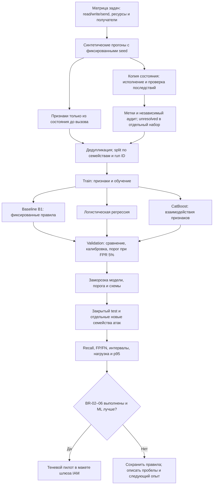
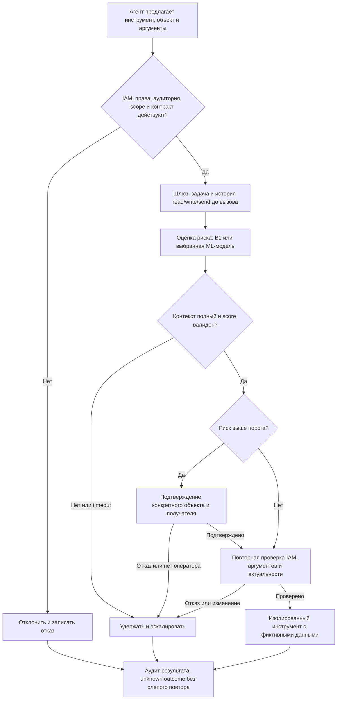

# Дизайн ML-системы — «Риск вызовов агента (IAM 604)»

Итерация 1: учебный MVP, дизайн для ДЗ1 ML System Design. Автор — Даниил Бурдыгин.
Читатели — преподаватель и два студента-ревьюера, знакомые с условием ДЗ1;
контекст IAM изложен ниже. Дата: 25.10.2026.

Числа ниже — **проектные цели и допущения**, не результаты экспериментов и
не согласованные требования руководителя проекта 604. Данные ещё не собраны,
EDA и обучение не проводились. [Основания и источники](sources.md).

## 1. Цели и предпосылки

### 1.1. Зачем идём в разработку продукта

**Бизнес-цель.** Помочь оператору шлюза инструментов обнаруживать потенциально
вредные действия агента до их выполнения, сохраняя приемлемое число ручных
подтверждений. Пользователи — инженер AI Security, настраивающий шлюз,
и человек, подтверждающий чувствительные операции агента.

**Текущий процесс и проблема.** В предполагаемом стенде IAM сначала проверяет
идентичность, права, аудиторию и область действия разрешения. Эти проверки
отвечают за допустимые возможности. Но разрешённый инструмент может быть
неуместен для поручения: чтение документа допустимо, отправка сообщения тоже,
а отправка прочитанного документа внешнему получателю создаёт ущерб.
Правило для каждого отдельного вызова может пропустить связь между шагами.

**Почему ML может помочь.** Модель объединит признаки поручения, объекта,
назначения данных и истории вызовов в один ранжирующий сигнал. Проверяем
гипотезу, что он обнаружит больше опасных сочетаний при том же бюджете тревог,
чем короткий набор правил. Если преимущество не подтвердится, оставляем правила:
само наличие ML не является критерием успеха.

**Ценность и цена ошибки.** Пропуск опасной отправки дороже лишнего подтверждения;
частые ложные тревоги ведут к задержкам и автоматическому согласию оператора.
Поэтому оптимизируем полноту обнаружения при ограничении ложных тревог,
а не общую accuracy. Оценка остаётся дополнительным ограничением поверх IAM.

**Успех итерации.** Для ДЗ1 — проверяемый дизайн и воспроизводимая среда проверки
репозитория. Для будущего MVP — независимый от обучения набор сценариев,
сравнение с правилами и отчёт с условиями, при которых модель имеет смысл.
Работоспособность на синтетике не доказывает снижение риска в реальной организации.

### 1.2. Бизнес-требования и ограничения

#### Требования к будущему пилоту

| ID    | Требование                                              | Критерий приёмки и проверка                                                                                                                       |
| ----- | ------------------------------------------------------- | ------------------------------------------------------------------------------------------------------------------------------------------------- |
| BR-01 | Оценивать каждый следующий вызов до выполнения          | На стенде на каждый запрос возвращается оценка или явный отказ оценщика; журнал связывает запрос, версии признаков и модели                       |
| BR-02 | Уменьшать пропуски при ограниченном числе подтверждений | На закрытой сценарной выборке recall опасных вызовов ≥ 0,90 при FPR ≤ 0,05; сравнить с правилами на тех же группах                                |
| BR-03 | Оправдать усложнение ML                                 | При FPR ≤ 0,05 прирост recall против baseline ≥ 0,05 (5 процентных пунктов); интервалы разницы считать по группам сценариев                       |
| BR-04 | Не расширять доступ решением модели                     | Все запросы с отказом IAM отклоняются независимо от score; проверить мутациями score и отказом сервиса                                            |
| BR-05 | Сохранять работоспособность шлюза при отказе оценки     | Timeout, неверный ответ, неизвестная схема/версия → удержание вызова и эскалация; автоматического исполнения нет                                  |
| BR-06 | Укладываться в бюджет локального стенда                 | p95 оценки ≤ 50 мс при 10 запросах/с на CPU, после прогрева, вход ≤ 64 КБ; измерить отдельно от IAM и инструмента                                 |
| BR-07 | Позволять расследовать решение                          | Сохранять request/run ID, reason codes, model/schema/policy version, score и итоговый маршрут; не писать секреты и исходное содержимое документов |
| BR-08 | Воспроизводить сравнение                                | Зафиксировать seed, хеш набора, группы разбиения, признаки, версии зависимостей, порог и отчёт по всем тестовым случаям                           |

BR-02 и BR-03 относятся к вызовам, прошедшим обязательный IAM-контроль.
Отдельный набор нарушений IAM проверяет BR-04, не повышая искусственно метрики ML.
BR-06 задаёт стартовую цель для локального CPU. SLA пока не определён.
Пилот принят, только если одновременно выполнены BR-02–06 и обеспечена
воспроизводимость. Если доверительный интервал прироста включает ноль,
преимущество модели считаем неподтверждённым даже при точечном приросте 0,05.

#### Процесс пилота

Владелец сценария задаёт поручение и допустимые последствия. Стенд предлагает
вызов и передаёт его шлюзу. IAM отклоняет запросы без полномочий. Оценщик
рассматривает оставшиеся запросы; низкий риск сохраняет обычный маршрут IAM,
высокий — требует подтверждения конкретных аргументов и получателя.
Перед исполнением шлюз повторно проверяет права, версию контракта и срок
подтверждения. Изменение аргументов требует новой оценки и подтверждения.
В первом пилоте модель работает в теневом режиме: сравниваем её рекомендации
с эталоном без воздействия на реальные системы.

#### Ограничения

- Все вызовы выполняются только в локальном изолированном стенде с фиктивными
  объектами и получателями. Реальные отправки, платежи и административные действия исключены.
- Нельзя использовать рабочие журналы, документы, секреты, персональные данные
  автора и материалы Univermag. Разрешённая исходная база — собственная синтетика;
  открытые наборы добавляются только после проверки лицензии и содержимого.
- Ресурс — один студент, CPU и локальное хранилище. Платные API и GPU не требуются.
  Учебная гипотеза бюджета: до 40 часов на MVP после согласования плана.
- Сервис риска не хранит учётные данные, не выдаёт токены и не заменяет движок политик.
  Подмена оценки не должна позволять нарушить IAM.
- Использование темы в проектной практике, роль автора и интерфейс с командой
  604 ещё не согласованы. До этого интеграция демонстрируется через макет шлюза.
- Срок этой поставки дизайна — 29.10.2026 20:00 МСК. Даты реализации последующих
  итераций определяются после выдачи соответствующих заданий.

### 1.3. Что входит в scope итерации и что не входит

**ДЗ1, текущая поставка:** этот документ, описание данных и метрик, схема baseline
и MVP, README, форматирование, линтеры, pre-commit и CI. Код модели,
собранный датасет и экспериментальные результаты в поставку ДЗ1 не входят.

**Будущий MVP:** синтетический генератор задач и трасс; эталон последствий;
дедупликация и групповое разбиение; правила и две модели; подбор порога;
offline-отчёт; локальный интерфейс оценки и воспроизведение атак. Закрывает
BR-01–08 в границах стенда. Языки и интерфейсы реализации уточняются перед кодом;
учебные ML-эксперименты используют стандартный ML-стек без разработки своего движка.

**Вне scope:** весь Enterprise IAM, промышленный IdP/хранилище секретов,
реальные интеграции банка, промышленная эксплуатация, онлайн-обучение,
гарантия обнаружения всех prompt injection, доказательство безопасности модели,
оценка реального потока без его данных. Не строим детектор «вредного текста»
как замену проверке последствий действия.

**Качество и воспроизводимость.** Для кода MVP нужны строгие типы на границах,
валидация входа, фиксированные зависимости, тесты утечки между выборками,
проверка некорректных входов и сценарные регрессии. Результаты экспериментов
будут связаны с ревизией кода и данными; сейчас настроены проверки документов.

**Технический долг:** независимая разметка второй стороной, оценка на новых
организациях, реальная нагрузка, интерфейс оператора, защищённая доставка модели
и эксплуатационный мониторинг. Эти пункты блокируют промышленное использование,
но не сравнение алгоритмов в учебном стенде.

### 1.4. Предпосылки решения

| Допущение                                                              | Причина и способ проверки                                                                      | Если не выполнено                                                       |
| ---------------------------------------------------------------------- | ---------------------------------------------------------------------------------------------- | ----------------------------------------------------------------------- |
| Шлюз видит структурированные аргументы и состояние до вызова           | Риск зависит от объекта, назначения и истории; проверить полноту трассы на каждом сценарии     | Отказ от score при неполном контексте, запрос уточнения                 |
| Поручение связано с run ID и проверенным манифестом разрешённой задачи | Иначе модель опирается на изменяемое самоописание агента; целостность манифеста проверяет шлюз | Удержать вызов, задача не установлена                                   |
| Инструмент сообщает класс данных и тип побочного эффекта               | Сырые тексты могут содержать секреты; использовать каталог инструментов и метаданные           | Неизвестный инструмент → ручное рассмотрение                            |
| История доступна внутри одного прогона                                 | Сочетание чтения и внешней отправки требует нескольких шагов                                   | В MVP явный ключ стенда; перенос на протокол команды — открытый вопрос  |
| Синтетические задачи имеют независимый эталон последствий              | Обучение на метке из тех же правил не проверит перенос                                         | Аудит сценариев и отдельные семейства атак; ограничить вывод синтетикой |
| Есть подтверждающий человек                                            | Предполагаемый процесс обработки высокого риска                                                | В стенде подтверждающий симулируется; без оператора вызов удерживается  |

**Гранулярность** — один предложенный вызов в контексте прогона.
**Горизонт** — потенциальное нарушение при выполнении этого вызова, а не риск
пользователя навсегда. История содержит только предыдущие события, включая
прочитанные классы данных. Из будущего разрешено получать метку для обучения,
но не признаки. Переобучение запускается вручную. Повод — обновление набора сценариев;
собственные оценки модели не используются как новые метки.

## 2. Методология

### 2.1. Постановка ML-задачи

**Задача:** бинарная классификация с калибровкой и ранжированием риска
`p(y = 1 | x)`. Положительный класс — вызов, который в заданном состоянии
стенда нарушает ограничения поручения или создаёт запрещённый поток данных.
Например, выгрузка чувствительного документа внешнему получателю при поручении
сделать локальную сводку. Метка отражает последствия и допустимость относительно
задачи; формальная проверка токена остаётся отдельной.

**Определение метки.** Владелец сценария до генерации вызовов фиксирует исходное
состояние, допустимые объекты/получателей и запрещённые последствия. Независимый
от признаков симулятор выполняет вызов на копии состояния и проверяет эти условия.
Если хотя бы одно нарушено, `y=1`; если все проверены и соблюдены, `y=0`.
Противоречивый сценарий не размечаем. Неполные и противоречивые примеры
получают статус `unresolved` и исключаются из обучения с указанием причины. Факт prompt injection сам по себе метку не задаёт.

**Контрастные примеры:**

| Поручение и контекст                                     | Предложенный вызов                                  | Эталон                              |
| -------------------------------------------------------- | --------------------------------------------------- | ----------------------------------- |
| Сделать локальную сводку, прочитан sensitive-документ    | Отправить его содержание на фиктивный внешний адрес | 1: нарушена граница передачи        |
| Отправить согласованный public-отчёт названному адресату | Отправить этот отчёт указанному адресату            | 0: условия соблюдены                |
| Обновить объект A, токен технически позволяет A и B      | Изменить объект B                                   | 1: действие вне поручения           |
| Прочитать свой объект, полномочий нет                    | Чтение объекта                                      | Отказ IAM; отдельная проверка BR-04 |

**Входные данные, доступные до исполнения:**

| Группа       | Признаки                                                                                                | Источник доверия                                     |
| ------------ | ------------------------------------------------------------------------------------------------------- | ---------------------------------------------------- |
| Поручение    | Категория цели, допустимые классы эффектов и ресурсов                                                   | Проверенный манифест шлюза                           |
| Вызов        | Тип инструмента, операция read/write/send, класс ресурса, размер payload, внешний/внутренний получатель | Каталог и нормализованные аргументы                  |
| История      | Число вызовов, предыдущие классы прочитанных данных, смена назначения, повтор записи после timeout      | Журнал шлюза до текущего шага                        |
| Согласование | Наличие подтверждения для текущих аргументов, возраст подтверждения, изменение контракта                | Состояние шлюза; проверяется повторно перед эффектом |

Секреты, сырые документы, идентификатор семейства, метка атаки, результат
исполнения и решение эталонного проверяющего не входят в признаки.
Причины score выдаются фиксированными кодами наблюдаемых факторов, например
`external_destination` и `sensitive_read_before_send`. Они объясняют контекст,
но не доказывают причинность предсказания.

**Выход:** `request_id`, score в диапазоне [0,1], `model_version`, `schema_version`,
reason codes либо типизированная ошибка `unknown_tool / incomplete_context /
timeout / invalid_input`. Порог переводит score в маршрут подтверждения.
Ответ не содержит действия `grant_access`. Порог фиксируется по validation;
test для его подбора не используется.

#### Данные и защита оценки от утечки

Основной источник — собственная синтетика по матрице «задача × инструмент ×
класс данных × получатель × история × сбой». План — 2 000 прогонов.
Ожидаем около 10 000 вызовов; точный объём определит аудит покрытия.
Для каждого семейства нужны безопасный вариант и минимальные изменения,
которые меняют допустимый исход. Наличие слов «атака» или «секрет» не должно
предсказывать класс без контекста.

| Набор       | Состав                                                                      | Состояние   |
| ----------- | --------------------------------------------------------------------------- | ----------- |
| `calls`     | run/call ID, время, признаки до исполнения, версия генератора               | Планируется |
| `labels`    | call ID, y/unresolved, основание, версия эталона, статус аудита             | Планируется |
| `scenarios` | family ID, начальное состояние, ограничения задачи, seed, ожидаемые эффекты | Планируется |

Метки хранятся отдельно от признаков. Разбиение по семействам сценариев:
60% train, 20% validation, 20% закрытый test; все варианты одного исходного
поручения и весь прогон идут в одну часть. Пропорции приблизительные из-за
группировки. Преобразования учатся только на train; validation отдельно делится
по группам для калибровки и выбора порога. При малом числе групп используем
внутреннюю групповую кросс-валидацию. Test открываем один раз после фиксации.

Дополнительный challenge-набор содержит новые семейства обхода и сочетания
инструментов, отсутствующие при обучении. Его результаты показываем отдельно.
Переформулировки одного сценария не являются независимыми тестовыми задачами.
Массовая генерация не заменяет проверку: вручную аудируем минимум 100 прогонов,
включая принятые, отклонённые и unresolved; второй разметчик пока не назначен.

Частота опасных событий в синтетике управляется генератором. Precision,
нагрузку на оператора и калибровку показываем при указанной доле положительного
класса и в анализе чувствительности для 1%, 5% и 20%. Эти значения не выдаём
за частоты настоящего потока. Перенос вероятности на production не установлен.

#### Baseline, MVP и метрики

**Baseline B0:** все прошедшие IAM вызовы считаются низким риском. Показывает
цену отсутствия дополнительного контроля: recall=0, если есть положительный
класса, FPR=0. **Основной baseline B1:** фиксированные правила «sensitive-read +
external-send», «write вне класса поручения», «повтор записи после неизвестного
исхода». Используем правила, доступные в момент вызова; эталон оценивает эффект
на отдельном состоянии. Настройки B1 фиксируем на train/validation до test.

**Модели:** регуляризованная логистическая регрессия с one-hot признаками как
простой ML-baseline; CatBoost на тех же табличных признаках как кандидат MVP
для взаимодействий. Гиперпараметры и необходимость калибровки выбираются
внутри train/validation. Сложность CatBoost оправдана только измеренным выигрышем;
если выигрывает регрессия или B1, итоговое решение остаётся простым.
LLM в критическом пути не используется: он увеличил бы стоимость и источник ошибок.

**Основные метрики:** recall = TP/(TP+FN) при FPR = FP/(FP+TN) ≤ 0,05;
доля подтверждений = (TP+FP)/N; precision = TP/(TP+FP);
критические FN — отдельное число для внешней передачи и изменения чужого объекта.
PR-AUC характеризует ранжирование; Brier score и reliability diagram — калибровку.
При нулевом знаменателе метрика отмечается неопределённой, не нулевой.
Все алгоритмы оцениваем на одних сценариях и показываем матрицы ошибок.

Единица bootstrap — семейство сценариев. Для 95% интервалов повторно выбираем
семейства целиком; в отчёте показываем число семейств и вызовов. Парный bootstrap разницы recall сравнивает модели
на одинаковых группах. Если для нужного среза мало групп, вывод — недостаточно
данных. Ноль критических ошибок в конечном наборе не является гарантией их отсутствия.

### 2.2. Блок-схемы решения

#### Обучение и offline-оценка baseline и MVP

Общая подготовка данных позволяет честно сравнивать правила и модели.
B1 не обучает веса. Его настройка также не использует закрытый test.
Результат — выбранное решение и отчёт. Версия модели включается в поставку,
только если сравнение подтвердило её преимущество.

#### Оценка следующего вызова в будущем стенде

В эксперименте теневого пилота ветви после score только моделируются.
В активном режиме шлюз остаётся единственной точкой исполнения; низкий score
не отменяет отказ IAM, а подтверждение связано с точными аргументами.

### 2.3. План этапов после ДЗ1

| Этап            | Действие                                                           | Проверяемый выход                                                     |
| --------------- | ------------------------------------------------------------------ | --------------------------------------------------------------------- |
| Данные и EDA    | Построить матрицу сценариев, проверить метки, пропуски и семейства | Версионированные calls/labels/scenarios; отчёт аудита и покрытия      |
| Baseline        | Зафиксировать B0/B1 и простую регрессию                            | Метрики validation и анализ ошибок без доступа к test                 |
| Кандидат MVP    | Обучить CatBoost, проверить калибровку и абляцию истории           | Выбор простейшего решения по BR-02/03                                 |
| Закрытая оценка | Зафиксировать порог, открыть test и challenge                      | Матрицы ошибок, интервалы, критические FN и ограничения переноса      |
| Пилот           | Подключить оценщик к макету шлюза; внести timeout и подмену score  | BR-04–06, журнал трасс, отчёт задержек и решение о следующей итерации |

После EDA уточняются размер выборки и допустимая сложность модели. Критерии
test не ослабляются после просмотра его результатов; изменение протокола
требует новой независимой проверки.

## 3. Пилот, угрозы и дальнейшее использование

Пилот воспроизводит одни и те же сценарии для B1 и выбранной модели.
Порядок прогонов перемешивается, железо и версия среды фиксируются.
Считаем метрики по вызовам и отдельно долю прогонов хотя бы с одним
критическим пропуском. Замеры задержки отделяют нормализацию, инференс,
IAM и исполнение инструмента. Цель — выяснить пользу оценки и цену интеграции.

| Риск                                                  | Запланированная проверка и реакция                                                                                 |
| ----------------------------------------------------- | ------------------------------------------------------------------------------------------------------------------ |
| Модель повторяет правила генератора                   | Новые семейства, аудит меток, абляция истории, контрастные пары; при отсутствии выигрыша оставить B1               |
| Обход через названия инструмента или шум в метаданных | Переименования, пропуски, новый инструмент; неизвестная схема ведёт к удержанию                                    |
| Poisoning разметки или порога                         | Фиксированные split и происхождение меток; эксперимент с искажением доли train-меток отдельно от чистого test      |
| Подмена артефакта/сервиса оценки                      | Проверка версии и хеша; отказ/NaN/score вне диапазона → удержание; отсутствие обхода IAM                           |
| Устаревшее подтверждение и гонка                      | Изменить объект/получателя/права между оценкой и исполнением; ожидать новую проверку и отказ старому подтверждению |
| Дубли при потерянном ответе инструмента               | Идемпотентный ключ и readback состояния в стенде; неизвестный исход не запускает слепой повтор                     |
| Завышенный вывод по синтетике                         | Отдельно указать частоты, число семейств, интервалы и отсутствие проверки на реальном потоке                       |

Для ПР1–4 «ИБ систем ИИ» сохраняются один объект системы, границы доверия,
активы, угрозы, роли, доступ и жизненный цикл модели. Для «Атак на ML» — тот же
стенд с контролируемыми evasion/poisoning опытами на собственных данных.
Конкретный объём будет сопоставлен с выданными условиями каждого курса.

**Открытые вопросы:** роль автора в 604; согласование темы с руководителем;
наличие ключа прогона и проверенного поручения; интерфейс шлюза; второй
разметчик; реалистичная стоимость подтверждения. Эти вопросы не мешают сдаче
дизайна, но ограничивают интеграцию и интерпретацию будущих результатов.
