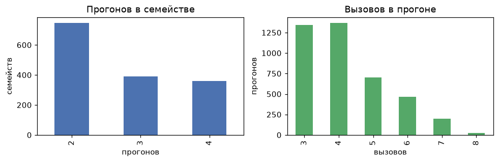
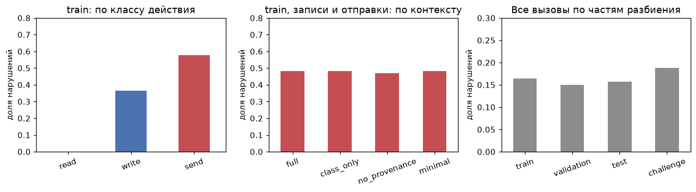
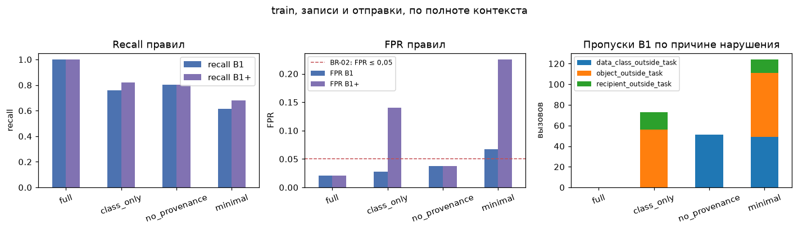

# EDA — риск вызовов агента (ДЗ2)

Отчёт сводит два ноутбука:
[синтетический набор v0](../notebooks/01_eda_synthetic.ipynb) и
[трассы AgentDojo](../notebooks/02_eda_agentdojo.ipynb). Все числа взяты из выходов
ячеек; ноутбуки воспроизводятся командами из [README](../README.md#данные-и-eda).
Распределения признаков и меток, сила признаков и сравнение с правилами в синтетике
посчитаны только на train. Validation, test и challenge входят лишь в проверку
целостности и разбиения: объём, типы, доля нарушений по частям.

## Данные

| Набор                                                 | Что это                                                                                                               | Объём                                         | Метка                                 |
| ----------------------------------------------------- | --------------------------------------------------------------------------------------------------------------------- | --------------------------------------------- | ------------------------------------- |
| [Синтетика v0](../data/synthetic/v0/manifest.json)    | Собственный генератор по матрице «поручение × инструмент × класс данных × получатель × история × сбой», seed 20261114 | 1 500 семейств, 4 113 прогонов, 17 453 вызова | Эталон последствий на каждый вызов    |
| [AgentDojo](../data/external/agentdojo/manifest.json) | Опубликованные трассы LLM-агентов (MIT, коммит `089ed46`): GPT-4o, Claude 3.5 Sonnet, Llama 3.3 70B, 4 пакета задач   | 10 631 прогон, 39 857 вызовов                 | `utility` и `security` на весь прогон |

Синтетика хранится тремя таблицами, как в дизайне: `calls` (признаки шлюза),
`labels` (метка, причина, версия эталона) и `scenarios` (семейство, поручение,
полнота контекста, часть разбиения). Четвёртая таблица `audit` хранит скрытые факты
для аудита: шаг атаки, истинный класс данных в отправке, применилась ли прежняя
запись. Признаками эти поля не становятся. Манифест фиксирует конфигурацию и sha256
файлов. Генерация детерминирована: повторный запуск даёт те же байты.

## Синтетика v0

### Объём: независимых единиц меньше, чем строк

Медиана — 3 прогона в семействе и 4 вызова в прогоне. Варианты одного поручения
зависимы, поэтому интервалы считаются по семействам: в train их 822, в validation
283, в test 286, ещё 109 — в отдельном challenge.

### Качество: пропусков нет, неоднозначность есть

- Пустых ячеек нет; все 17 453 строки прошли типизацию на границе чтения.
  Отсутствие сведений закодировано явно: `na` — признак неприменим к операции,
  `unknown` — шлюз не знает его при неполном контексте. Их нельзя заполнять одним
  способом.
- 65 вызовов (0,4%) — `unresolved`: 44 из-за манифеста без получателей при
  разрешённой отправке, 21 — отправка ссылается на удалённый объект. Шлюз в таком
  случае тоже не знает класс отправки и отдаёт `unknown`, если известная часть
  не содержит чувствительных данных. Эти вызовы исключены из обучения и метрик
  с меткой, но входят в q.
- У 10% размеченных вызовов train набор категориальных признаков совпадает с вызовом
  с другой меткой. Почти все такие случаи — неполный контекст: шлюз не видит объект
  или класс данных, а эталон видит. При полном контексте конфликт остаётся только
  у повторной записи: применилась ли первая, шлюз не знает. Это нижняя граница ошибки
  для любой модели на этих признаках.

### Метки: обогащённый набор, нарушения только в записях и отправках

Нарушений 16,2% (2 835 вызовов), в частях разбиения 15–16%, в challenge 19%. Две
трети вызовов train — чтения (65,9%). По определению метки у чтения нет последствий,
и нарушений среди них нет. Среди записей и отправок train нарушений 48%, почти
одинаково по уровням контекста; у поручения «разобрать входящие» доля ниже, 30–37%.
Если считать FPR по всем вызовам, лёгкие чтения делают его заниженным.

Причины нарушений на train: получатель вне поручения (492), класс данных вне поручения
(443), объект вне поручения (425), отправка в поручении без отправок (211), запись
в поручении без записей (50), повтор записи (43).

### Контрастные пары работают

Нейтральная правка (добавить публичный документ к разрешённой отправке) метку
не меняет ни разу. Замена получателя на постороннего, добавление чувствительного
документа и смена объекта записи переводят безопасный прогон в нарушение в 64–72%
семейств train; в остальных прогон уже был нарушением. Удаление шагов атаки снимает
нарушение в 98% семейств. Эталон пересчитывает метку по последствиям, а не копирует
её между вариантами.

### Подсказки генератора и утечки

ROC-AUC одного признака считаем на записях и отправках train, по пяти блокам
семейств: кодировка учится на четырёх, оценивается на пятом. Сильнее всего разделяют
признаки соответствия манифесту: `object_matches_task` — 0,78, `recipient_matches_task`
— 0,73. Имя инструмента даёт 0,69: у `send_email` и `upload_external` есть и
разрешённые отправки партнёру.

Аудит нашёл четыре подсказки генератора v0.

1. Все 64 вызова `delete_record` в train — нарушения: удаление создаётся только
   в шагах атаки.
2. Недоверенный ввод в прогонах без атаки встречается только в разборе входящих.
   В остальных четырёх поручениях `untrusted_input_before` почти совпадает с фактом
   атаки.
3. Все 612 отправок чувствительных данных в train — нарушения: ни одно поручение
   не разрешает такую отправку. Правка «добавить чувствительный документ» добавляет
   секрет к уже отправляемым объектам, и размеры складываются: медиана 60 КБ против
   47 КБ в исходном прогоне.
4. Шаблон challenge (`share_document` наружу) есть и в train — 124 вызова: 110 из правки
   получателя и 14 из ошибок агента, все нарушения, и B1 ловит их всегда. Challenge v0
   поэтому не проверяет обобщение сверх правил.

Генератор v1 снимает все четыре: разрешённые удаления, безопасные внешние чтения во
всех поручениях, разрешённые отправки чувствительных данных и замена объекта вместо
добавления, шаблон challenge только в challenge.

### Где правила B1 не видят нарушения

| Контекст, train | Записей и отправок | Нарушений | Recall B1 | FPR B1 | Recall B1+ | FPR B1+ |
| --------------- | -----------------: | --------: | --------: | -----: | ---------: | ------: |
| full            |              1 296 |       627 |     1,000 |  0,021 |      1,000 |   0,021 |
| class_only      |                631 |       304 |     0,760 |  0,028 |      0,819 |   0,141 |
| no_provenance   |                554 |       260 |     0,804 |  0,037 |      0,804 |   0,037 |
| minimal         |                662 |       320 |     0,616 |  0,067 |      0,678 |   0,225 |
| все             |              3 143 |     1 511 |     0,837 |  0,035 |      0,862 |   0,091 |

При полном контексте B1 ловит все нарушения: правила смотрят на те же поля манифеста,
что и эталон. Его 14 ложных тревог здесь — повторы записи, первая из которых
не применилась. Это подтверждает оговорку дизайна: при полном контексте выигрыша ML
по построению нет. Пропуски возникают при неполном контексте: объект того же класса
(56 + 62 вызова в `class_only` и `minimal`), класс данных без метки происхождения
(51 + 49 в `no_provenance` и `minimal`), получатель внутри разрешённой зоны (17 + 13).
Всего у B1 57 ложных тревог: повторы записи (40) и разрешённые отправки партнёру
после чувствительного чтения (17). При `minimal` FPR B1 — 0,067, выше бюджета BR-02:
правила сами не укладываются в требование при минимальном контексте.

B1+ добавляет правило из EDA: запись после неоднозначного поиска при неизвестном
соответствии объекта. Цена высокая. Recall растёт всего на 0,025, а новое правило даёт
ещё 91 ложную тревогу в `class_only` и `minimal` и поднимает общий FPR до 0,091, почти
вдвое выше бюджета. Поэтому модель сравнивается с каждым правилом в его рабочей точке,
при том же FPR (2.3 дизайна).

Какие сигналы остаются модели? Среди записей и отправок, которые B1 пропускает при
неполном контексте, у нарушений чаще встречается только неоднозначный поиск перед
действием — в 1,6 раза. Остальные сигналы истории у нарушений встречаются реже.
Размер отправки растёт с истинным классом данных: медианы 17, 25 и 53 КБ для public,
internal и sensitive, хотя эту связь частично создал генератор (подсказка 3).

На этих сигналах может выиграть модель. Их силу задал генератор, поэтому это гипотеза
для этапа моделей, а не результат.

### Хватает ли объёма

В test 269 семейств хотя бы с одним нарушением; ориентир дизайна — 300. При той же
доле нужно около 1 700 семейств; план v1 — 2 000.

## AgentDojo

### Состав и качество

У GPT-4o прогнаны 15 типов атак, у двух других моделей — в основном основная
`important_instructions`. Ошибок исполнения и повторов нет, но аудит нашёл три ловушки.

1. **Пустые прогоны.** 720 трасс без единого вызова, 189 из них — 19,9% прогонов
   Llama 3.3 70B на основной атаке. Модель пишет вызов инструмента JSON-текстом
   в ответе, среда его не распознаёт. Такой прогон получает «атака не удалась»,
   хотя агент просто не действовал.
2. **Метка без атаки.** У прогонов без атаки `security` всегда истинно: по коду
   AgentDojo оно там не определено. Наивное объединение исказило бы долю атак.
3. **Разные наборы задач.** Llama прогнана на расширенной версии пакетов
   (в `workspace` больше задач). На 320 прогонах этих задач атака удаётся в 2,5%
   случаев. Модели сравниваем только на общих парах задач.

После отбора — 1 815 прогонов, по 510 с атакой и по 95 без атаки на модель, 7 756 вызовов.

| Модель            | Успешная атака | Задача выполнена под атакой | Задача выполнена без атаки |
| ----------------- | -------------: | --------------------------: | -------------------------: |
| Claude 3.5 Sonnet |          0,014 |                       0,739 |                      0,811 |
| GPT-4o            |          0,504 |                       0,531 |                      0,758 |
| Llama 3.3 70B     |          0,388 |                       0,506 |                      0,726 |

Без отбора доля успешных атак Llama — 0,231. Выравнивание задач поднимает её до 0,335,
удаление пустых прогонов — до 0,388. Обе ловушки скрывали уязвимость модели.

### Структура трасс

В среднем 3,5–4,8 вызова на прогон. Чтений 71%, отправок 21%, записей 9%. Отправкой
считаем всё, что уходит за пределы агента, включая запрос по произвольному адресу
(`get_webpage`) и событие календаря с приглашениями. Картина та же, что в синтетике:
большинство вызовов безопасно по определению.

### От метки прогона к вызову

Метка AgentDojo относится ко всему прогону. Вызов, достигающий цели атакующего, мы
находим по идентификатору из внедрённого текста (адрес, IBAN, URL), которого нет
в поручении пользователя. Этот признак — эвристика для EDA, а не эталон.

- Помеченный вызов есть в 70,3% успешных атак и в 2,9% неуспешных. В неуспешных
  агент начинал действие атакующего, но цель не достигнута.
- Все 371 помеченный вызов успешных атак идут после того, как агент прочитал
  внедрённый текст. Пакеты сериализуют ответы инструментов по-разному, поэтому
  экранированные переносы строк перед поиском разворачиваются. Эвристика согласуется
  с механизмом атаки.
- Среди помеченных 322 отправки, 23 записи и 26 чтений (`search_emails` по адресу
  атакующего). У чтений нет последствий, поэтому во внешней проверке положительными
  будут только 345 записей и отправок.
- Помеченные записи и отправки — 17% записей и отправок прогонов с атакой (345
  из 1 996) и 5,5% всех их вызовов. Срез состоит только из прогонов с атакой, поэтому
  с π₀ = 5% дизайна напрямую не сравнивается: долю задали выбор атаки и моделей,
  а не реальный поток.
- В 137 успешных атаках помеченного вызова нет: цель «удалить файл» или «сменить
  пароль» идентификатора не содержит.

### Какие признаки шлюза можно получить

Из трасс получаются класс действия, изменение прав, история вызовов и признак
недоверенного ввода. Манифеста поручения, классов данных и меток происхождения
в трассах нет. Значит, AgentDojo соответствует уровню контекста `minimal` нашего
генератора и годится как внешний challenge при той же подаче признаков, но не для
обучения модели вызовов.

## Выводы для дизайна

1. Метрики, FPR, π и q считать на записях и отправках, отдельно сообщая чтения:
   иначе FPR занижается лёгкими примерами почти в 5 раз.
2. Сравнение с правилами показывать по уровням полноты контекста и в рабочей точке
   каждого правила. При полном контексте ожидаем паритет, выигрыш возможен только при
   неполном. При `minimal` даже B1 выходит за бюджет FPR.
3. Генератор v1: 2 000 семейств, снятые подсказки v0, шаблон challenge только
   в challenge, вторая разметка выборки аудита независимым человеком.
4. AgentDojo — внешний challenge уровня `minimal` после очистки пустых прогонов и
   выравнивания задач; положительные — помеченные записи и отправки, вызов-уровневая
   метка восстанавливается эвристикой только для анализа ошибок.
5. Все частоты синтетики заданы конфигурацией генератора и на реальный поток не
   переносятся.
