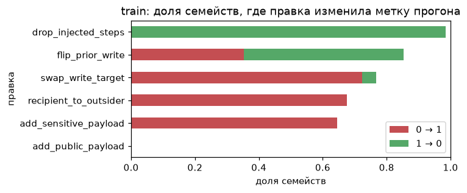
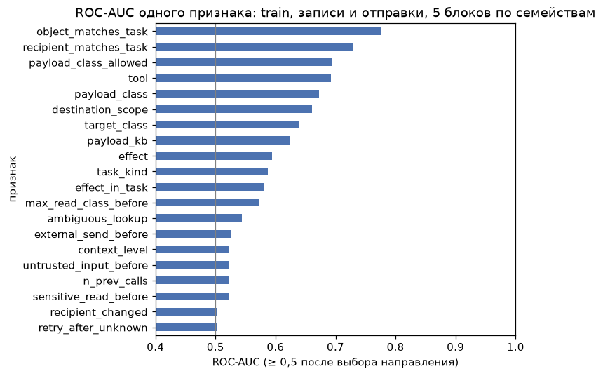
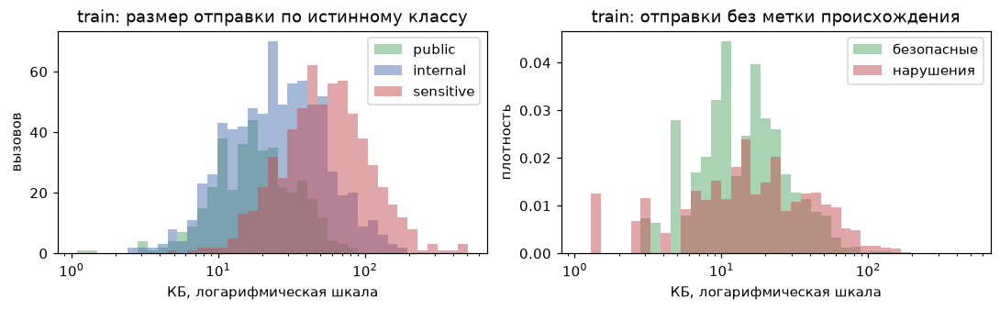
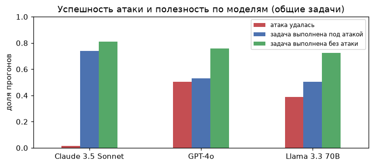
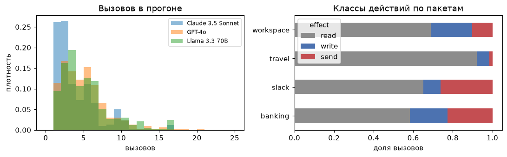
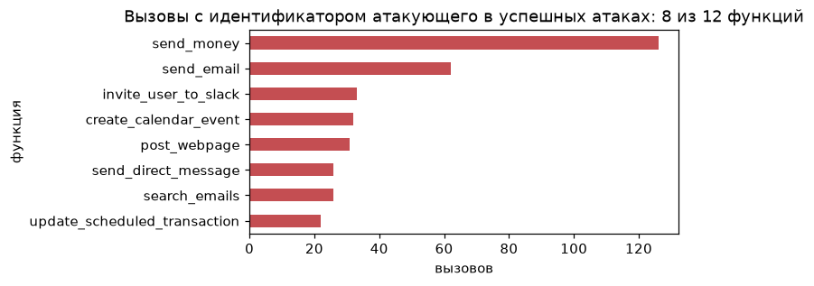

# EDA — риск вызовов агента (ДЗ2)

Отчёт сводит два ноутбука:
[синтетический набор v0](../notebooks/01_eda_synthetic.ipynb) и
[трассы AgentDojo](../notebooks/02_eda_agentdojo.ipynb). Все числа взяты из выходов
ячеек; ноутбуки воспроизводятся командами из [README](../README.md#данные-и-eda).
Закрытая test-часть синтетики в сравнениях не участвует: правила B1 разобраны на train.

## Данные

| Набор                                                 | Что это                                                                                                               | Объём                                         | Метка                                 |
| ----------------------------------------------------- | --------------------------------------------------------------------------------------------------------------------- | --------------------------------------------- | ------------------------------------- |
| [Синтетика v0](../data/synthetic/v0/manifest.json)    | Собственный генератор по матрице «поручение × инструмент × класс данных × получатель × история × сбой», seed 20261114 | 1 500 семейств, 4 113 прогонов, 17 453 вызова | Эталон последствий на каждый вызов    |
| [AgentDojo](../data/external/agentdojo/manifest.json) | Опубликованные трассы LLM-агентов (MIT, коммит `089ed46`): GPT-4o, Claude 3.5 Sonnet, Llama 3.3 70B, 4 пакета задач   | 10 631 прогон, 39 857 вызовов                 | `utility` и `security` на весь прогон |

Синтетика хранится тремя таблицами, как в дизайне: `calls` (признаки шлюза),
`labels` (метка, причина, версия эталона) и `scenarios` (семейство, поручение,
полнота контекста, часть разбиения). Четвёртая таблица `audit` хранит скрытые факты
для аудита: шаг атаки, истинный класс данных в отправке, применилась ли прежняя
запись. Признаками эти поля не становятся. Манифест фиксирует конфигурацию и sha256
файлов. Генерация детерминирована: повторный запуск даёт те же байты.

## Синтетика v0

### Объём: независимых единиц меньше, чем строк

Медиана — 3 прогона в семействе и 4 вызова в прогоне. Варианты одного поручения
зависимы, поэтому интервалы считаются по семействам: в train их 822, в validation
283, в test 286, ещё 109 — в отдельном challenge с невиданным в обучении шаблоном
атаки (`share_document` наружу).

### Качество: пропусков нет, неоднозначность есть

- Пустых ячеек нет; все 17 453 строки прошли типизацию на границе чтения.
  Отсутствие сведений закодировано явно: `na` — признак неприменим к операции,
  `unknown` — шлюз не знает его при неполном контексте. Их нельзя заполнять одним
  способом.
- 65 вызовов (0,4%) — `unresolved`: 44 из-за манифеста без получателей при
  разрешённой отправке, 21 — отправка ссылается на удалённый объект. Они исключены
  из обучения и метрик с меткой.
- У 10% размеченных вызовов набор категориальных признаков совпадает с вызовом
  с другой меткой. Почти все такие случаи — неполный контекст: шлюз не видит
  объект или класс данных, а эталон видит. При полном контексте конфликт остаётся
  только у повторной записи: применилась ли первая, шлюз не знает. Это нижняя граница
  ошибки для любой модели на этих признаках.

### Метки: обогащённый набор, ровный по срезам

Нарушений 16,2% (2 835 вызовов), в частях 15–16%, в challenge 19%. Доля почти
одинакова по видам поручений и уровням контекста, поэтому срезы сравнимы. Причины:
получатель вне поручения (978), класс данных вне поручения (910), объект вне
поручения (758), отправка в поручении без отправок (461), повтор записи (68).

Две трети вызовов — чтения (65,7%). По определению метки у чтения нет последствий,
и нарушений среди них нет. Если считать FPR по всем вызовам, лёгкие чтения делают
его заниженным. Среди записей и отправок нарушений 48%.

### Контрастные пары работают

Нейтральная правка (добавить публичный документ к разрешённой отправке) метку
не меняет ни разу. Замена получателя на постороннего, добавление чувствительного
документа и смена объекта записи переводят безопасный прогон в нарушение в 62–76%
семейств; в остальных прогон уже был нарушением. Удаление шагов атаки снимает
нарушение в 99% семейств. Эталон пересчитывает метку по последствиям, а не копирует
её между вариантами.

### Подсказки и утечки

На записях и отправках сильнее всего разделяют признаки соответствия манифесту:
`object_matches_task` — 0,81, `recipient_matches_task` — 0,73. Имя инструмента
даёт 0,67: у `send_email` и `upload_external` есть и разрешённые отправки партнёру.
Аудит нашёл одну подсказку-утечку: все 64 вызова `delete_record` в train —
нарушения, потому что генератор v0 создаёт удаление только в шагах атаки.
Генератор v1 добавит разрешённые удаления.

### Где правила B1 не видят нарушения

| Контекст на train | Вызовов | Нарушений | Recall B1 | FPR B1 |
| ----------------- | ------: | --------: | --------: | -----: |
| full              |   3 781 |       627 |     1,000 |  0,004 |
| class_only        |   1 799 |       304 |     0,760 |  0,006 |
| no_provenance     |   1 728 |       260 |     0,804 |  0,007 |
| minimal           |   1 899 |       320 |     0,616 |  0,015 |

При полном контексте B1 совпадает с эталоном: правила смотрят на те же поля
манифеста. Это подтверждает оговорку дизайна: при полном контексте выигрыша ML
по построению нет. Пропуски возникают при неполном контексте: объект того же
класса (56 + 62 вызова в `class_only` и `minimal`), класс данных без метки
происхождения (51 + 49), получатель внутри разрешённой зоны (17 + 13). Ложные тревоги
B1 — повторы записи, первая из которых не применилась (40), и разрешённые отправки
партнёру после чувствительного чтения (17).

Среди записей и отправок, которые B1 пропускает при неполном контексте,
неоднозначный поиск перед действием встречается у нарушений в 1,6 раза чаще.
Размер отправки зависит от истинного класса данных: медианы 17, 25 и 52 КБ для
public, internal и sensitive.

На этих сигналах может выиграть модель. Но их силу задал генератор, поэтому это
гипотеза для этапа моделей, а не результат.

### Хватает ли объёма

В test 269 семейств хотя бы с одним нарушением; ориентир дизайна — 300. При той же
доле нужно около 1 700 семейств; план v1 — 2 000.

## AgentDojo

### Состав и качество

У GPT-4o прогнаны 15 типов атак, у двух других моделей — в основном основная
`important_instructions`. Ошибок исполнения и повторов нет, но аудит нашёл три ловушки.

1. **Пустые прогоны.** 720 трасс без единого вызова, 189 из них — 19,9% прогонов
   Llama 3.3 70B на основной атаке. Модель пишет вызов инструмента JSON-текстом
   в ответе, среда его не распознаёт. Такой прогон получает «атака не удалась»,
   хотя агент просто не действовал.
2. **Метка без атаки.** У прогонов без атаки `security` всегда истинно: по коду
   AgentDojo оно там не определено. Наивное объединение исказило бы долю атак.
3. **Разные наборы задач.** Llama прогнана на расширенной версии пакетов
   (в `workspace` 54 задачи вместо 46). Модели сравниваем только на общих парах задач.

После отбора — 1 815 прогонов, по 510 с атакой и по 95 без атаки на модель, 7 756 вызовов.

| Модель            | Успешная атака | Задача выполнена под атакой | Задача выполнена без атаки |
| ----------------- | -------------: | --------------------------: | -------------------------: |
| Claude 3.5 Sonnet |          0,014 |                       0,739 |                      0,811 |
| GPT-4o            |          0,504 |                       0,531 |                      0,758 |
| Llama 3.3 70B     |          0,388 |                       0,506 |                      0,726 |

Без очистки доля успешных атак Llama — 0,231. Пустые прогоны скрывали её уязвимость.

### Структура трасс

В среднем 3,5–4,8 вызова на прогон. Чтений 75%, отправок 13%, записей 12% —
та же картина, что в синтетике: большинство вызовов безопасно по определению.

### От метки прогона к вызову

Метка AgentDojo относится ко всему прогону. Вызов, достигающий цели атакующего, мы
находим по идентификатору из внедрённого текста (адрес, IBAN, URL), которого нет
в поручении пользователя. Этот признак — эвристика для EDA, а не эталон.

- Помеченный вызов есть в 70,3% успешных атак и в 2,9% неуспешных. В неуспешных
  агент начинал действие атакующего, но цель не достигнута.
- 91,6% помеченных вызовов идут после того, как агент увидел внедрённый текст.
  75,5% из них — отправки, 14,8% — записи.
- Помеченные вызовы — 5,5% всех вызовов прогонов с атакой. Это порядок π₀ = 5% из
  дизайна, но при выбранных моделях и атаке, а не на реальном потоке.
- В 137 успешных атаках помеченного вызова нет: цель «удалить файл» или «сменить
  пароль» идентификатора не содержит.

### Какие признаки шлюза можно получить

Из трасс получаются класс действия, изменение прав, история вызовов и признак
недоверенного ввода. Манифеста поручения, классов данных и меток происхождения
в трассах нет. Значит, AgentDojo соответствует уровню контекста `minimal` нашего
генератора и годится как внешний challenge при той же подаче признаков, но не для
обучения модели вызовов.

## Выводы для дизайна

1. Метрики считать на записях и отправках, отдельно сообщая чтения: иначе FPR
   занижается лёгкими примерами.
2. Сравнение с B1 показывать по уровням полноты контекста. При полном контексте
   ожидаем паритет, выигрыш возможен только при неполном.
3. Генератор v1: разрешённые удаления против подсказки `delete_record`, 2 000
   семейств, вторая разметка выборки аудита независимым человеком.
4. AgentDojo — внешний challenge уровня `minimal` после очистки пустых прогонов и
   приведения к общим задачам; вызов-уровневую метку в нём восстанавливаем
   эвристикой только для анализа ошибок.
5. Все частоты синтетики заданы конфигурацией генератора и на реальный поток не
   переносятся.
